# ES React Components (`@elsesourav/react-ui`)

<p align="center">
  
</p>

<p align="center">
  <a href="https://www.npmjs.com/package/@elsesourav/react-ui"></a>
  <a href="https://github.com/elsesourav/es-react-components"></a>
  <a href="https://www.typescriptlang.org/"></a>
  <a href="https://tailwindcss.com/"></a>
  <a href="https://components.elsesourav.com"></a>
  <a href="LICENSE"></a>
</p>

<p align="center">
  <strong>Modular, Physical 3D Micro-Depth UI Component Suite & Interactive Documentation Showcase for React 19</strong>
</p>

<p align="center">
  <a href="https://components.elsesourav.com"><strong>Explore Live Interactive Showcase »</strong></a>
  <br />
  <br />
  <a href="#-visual-showcase--platform-presentation">Showcase Gallery</a> •
  <a href="#-core-architectural-pillars">Architecture</a> •
  <a href="#-component-catalog-81-primitives">Component Catalog</a> •
  <a href="#-open-source-provenance--custom-modifications">Provenance</a> •
  <a href="#-quick-start">Quick Start</a>
</p>

---

## 🏛️ Ecosystem Purpose

**ES React Components** (`@elsesourav/react-ui`) is the primary design system and modular component suite engineered specifically for **[ElseSourav](https://elsesourav.com)** web applications, portals, and platforms.

The library was developed to solve three core engineering challenges across ElseSourav projects:
1. **Dynamic Theme Customization**: Complete decoupling of visual styling from hardcoded utility classes. The entire suite operates on reactive HSL and elevation CSS custom properties, allowing instant theme switching and custom palette creation without DOM re-renders or CSS-in-JS runtime penalties.
2. **Tactile 3D Micro-Depth**: Bringing physical hardware ergonomics (sunken well depressions, specular top-hairline highlights, tactile keycaps with 1.5px physical travel) to modern web interfaces while avoiding noisy blur artifacts.
3. **Unified Interaction & Accessibility**: Standardizing keyboard navigation, WAI-ARIA compliance, and spring gesture physics across 81+ production-ready primitives.

---

## 📸 Visual Showcase & Platform Presentation

All presentation assets are framed in pure **16:9 Desktop Application Mode** (`1920 × 1080 px`) with authentic macOS window chrome and zero distracting marketing clutter.

### 1. Hero Presentation Banners

#### Desktop 21:9 Ultrawide Hero Banner (`2520 × 1080 px`)
<p align="center">
  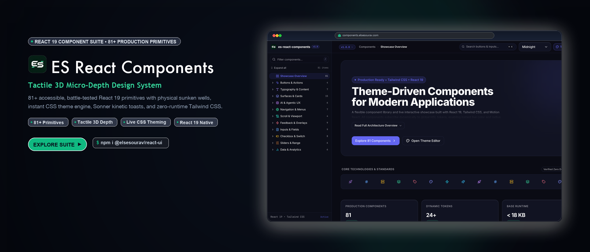
</p>

<table width="100%">
  <tr>
    <td width="50%" align="center">
      <strong>16:9 Desktop Landscape Cover (1600 × 900)</strong><br/><br/>
      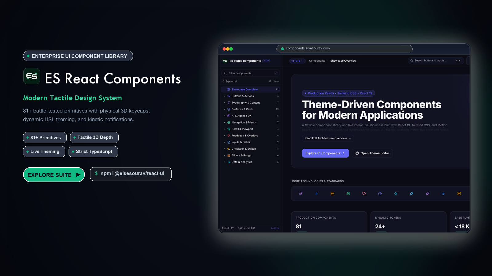
    </td>
    <td width="50%" align="center">
      <strong>3:4 Mobile / Portrait Slide (1200 × 1600)</strong><br/><br/>
      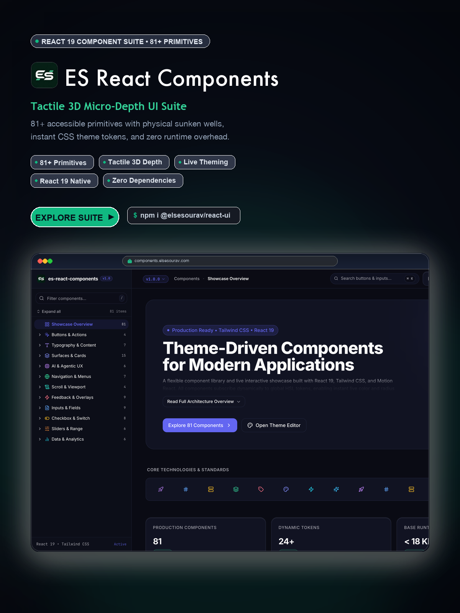
    </td>
  </tr>
  <tr>
    <td width="50%" align="center">
      <strong>v1.1.0 Devlog Update Banner (1600 × 900)</strong><br/><br/>
      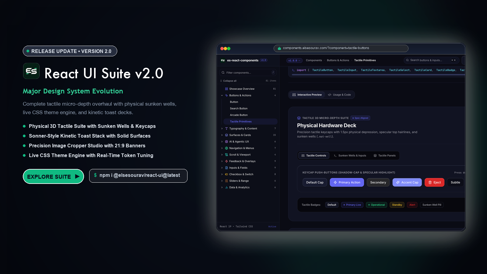
    </td>
    <td width="50%" align="center">
      <strong>3:4 Portrait App Store Cover (1200 × 1600)</strong><br/><br/>
      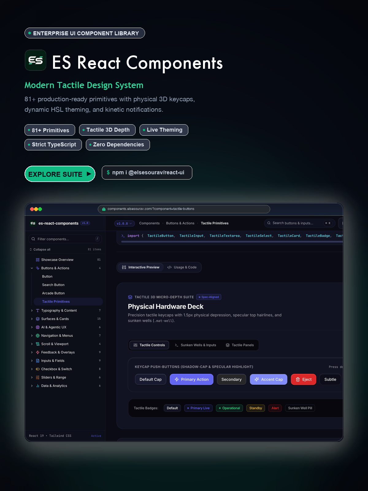
    </td>
  </tr>
</table>

---

### 2. High-Resolution Desktop Application Screenshots (16:9 Full HD)

#### 01. Showcase Overview & 81+ Component Matrix
> Interactive dashboard featuring live search filters, category navigators, and architecture inspection.
<p align="center">
  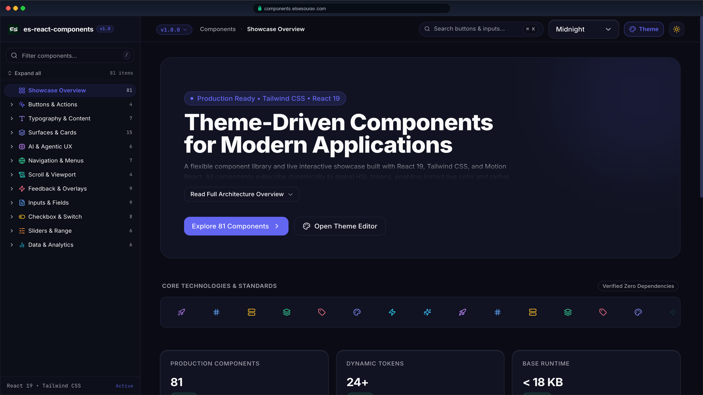
</p>

#### 02. Physical 3D Tactile Suite & Hardware Deck
> Precision keycaps with 1.5px physical travel, specular top hairlines, and sunken `.mat-well` surfaces.
<p align="center">
  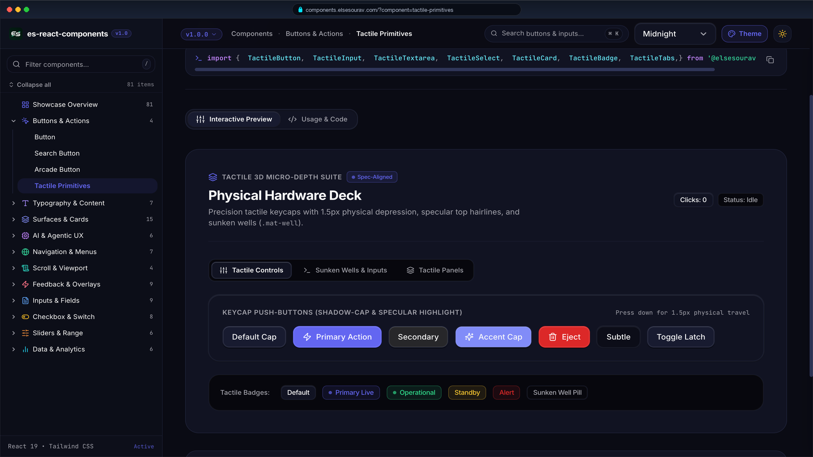
</p>

#### 03. Live Theme Engine & Preset Switcher Drawer
> Instant CSS token switching across 6 curated presets with live HSL color customizers.
<p align="center">
  
</p>

#### 04. 3D Kinetic Sonner-Style Notification Card Deck
> Solid opaque toast cards with elevation shadows, bidirectional gesture dismissals, and multi-dock anchors.
<p align="center">
  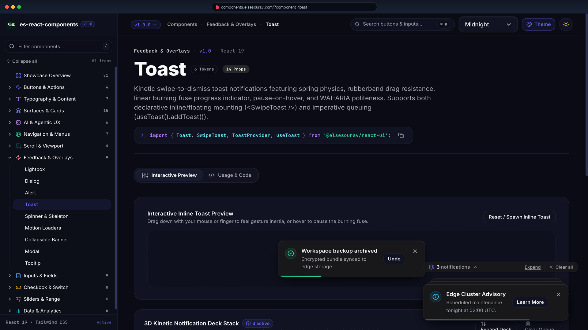
</p>

#### 05. Precision Image Cropper & Aspect Ratio Studio
> Expanded `max-w-5xl` modal with locked aspect ratio presets (21:9, 16:9, 3:4, 1:1, 9:16) and direct clipboard paste.
<p align="center">
  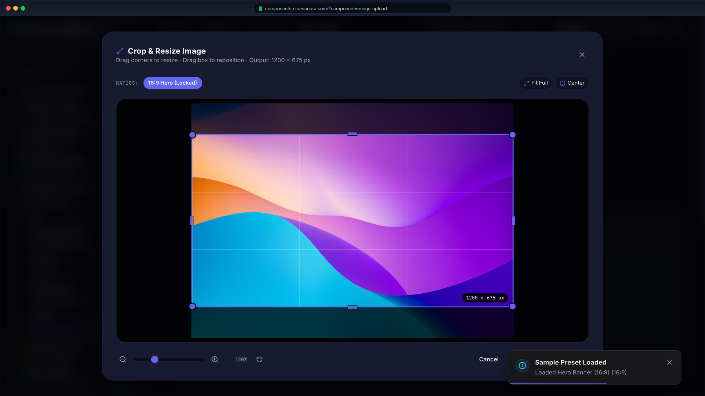
</p>

#### 06. Monochrome Data & Analytics Recharts Suite
> High-contrast minimalist analytics suite (Line, Bar, Area, Donut, Stream) synced to active theme tokens.
<p align="center">
  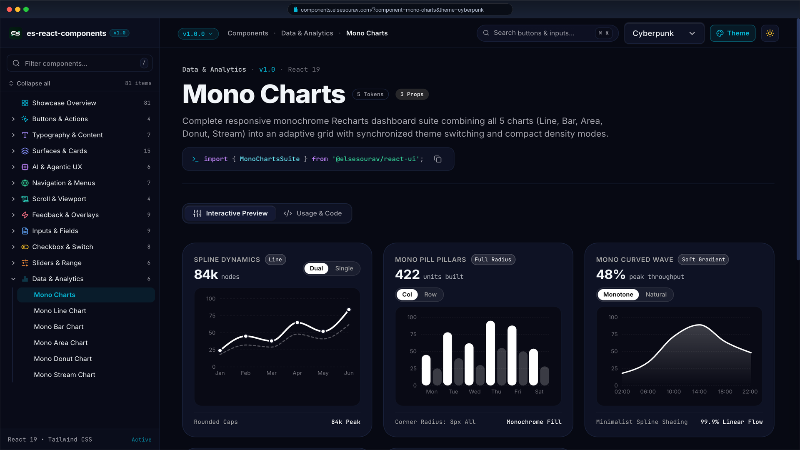
</p>

---

### 3. Platform App Icons & Brand Assets

<table width="100%">
  <tr>
    <td align="center" width="33%">
      <strong>Transparent App Icon (512 × 512)</strong><br/><br/>
      
    </td>
    <td align="center" width="33%">
      <strong>Cyber Night Chamfer Squircle (512 × 512)</strong><br/><br/>
      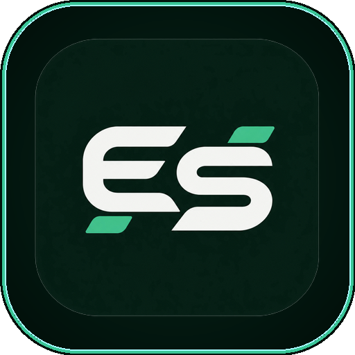
    </td>
    <td align="center" width="33%">
      <strong>Master Scalable Vector SVG</strong><br/><br/>
      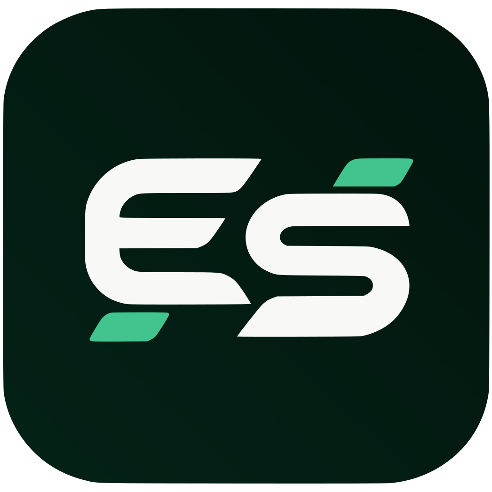
    </td>
  </tr>
</table>

---

## ⚡ Core Architectural Pillars

### 1. Tactile 3D Micro-Depth Engine
Unlike typical flat UI kits or overly blurred skeuomorphic implementations, ES React Components relies on mechanical depth physics:
- **Physical Key Depression**: Active elements physically compress by `1.5px` (`translate-y-[1.5px]`).
- **Specular Hairlines**: A 1px top highlight mimics overhead directional lighting.
- **Sunken Wells**: Inner well shadows (`.mat-well`) produce authentic recessed socket cavities for inputs and containers.
- **Elevation Tokens**: Standardized CSS variables:
  - `--shadow-lift`: Subtle ambient elevation for resting cards.
  - `--shadow-well`: Recessed depression shadows for wells and inputs.
  - `--shadow-cap`: Physical push-button bottom extrusion.
  - `--shadow-float`: High-z-index overlays and dropdowns.

### 2. Zero-Runtime Dynamic Theme Engine
All 81+ primitives bind directly to CSS custom properties mapped in `tailwind.config.ts`. Modifying variables updates the root DOM instantly:
```css
:root {
  --primary: 238.7 83.5% 66.7%;
  --background: 240 18% 4.5%;
  --surface: 240 16% 7%;
  --foreground: 0 0% 98%;
  --border: 240 14% 16%;
  --radius: 12px;
  --well: 240 20% 3.5%;
  --panel: 240 16% 9%;
}
```

#### Ships With 6 Verified Theme Presets
- 🌌 **Midnight Space**: Deep void indigo with electric cobalt accents.
- ☀️ **Clean Light**: High-contrast white canvas with slate typography.
- ⚡ **Cyberpunk Neon**: Jet black background with hyper-saturated neon cyan and pink accents.
- 🌿 **Emerald Matrix**: High-tech obsidian dark matrix with mint and emerald glows.
- 🌅 **Sunset Glow**: Warm twilight tones with vibrant amber and coral accents.
- 🌊 **Oceanic Abyss**: Dark abyssal blue with bioluminescent teal highlights.

---

## 🧩 Component Catalog (81+ Primitives)

| Category | Primitives Count | Included Components |
| :--- | :---: | :--- |
| **Tactile 3D Suite** | 7 | `TactileButton`, `TactileInput`, `TactileTextarea`, `TactileSelect`, `TactileCard`, `TactileTabs`, `TactileBadge` |
| **Buttons & Actions** | 4 | `Button`, `ArcadeButton`, `KeycapButton`, `InteractivePressable` |
| **Forms & Inputs** | 12 | `Input`, `FloatingLabelInput`, `PasswordInput`, `OtpInput`, `TagInput`, `ExpandingSearch`, `Textarea`, `Select`, `Switch`, `SquishSwitch`, `Checkbox`, `QuantityCounter` |
| **Typography & Content** | 7 | `Badge`, `Avatar`, `TextLoop`, `SplitFlapText`, `MarkdownRenderer`, `Tag`, `Kbd` |
| **Surfaces & Cards** | 15 | `Card`, `Stat`, `LeaderboardTable`, `TreeView`, `ReorderList`, `LiquidGlassSheet`, `GlassCard`, `Accordion`, `Tabs`, `Separator`, etc. |
| **Media & Studio** | 6 | `ImageUpload`, `ImageCropUpload`, `BlurUpImage`, `Lightbox`, `CardCoverflow`, `CardCarousel` |
| **Feedback & Overlays** | 9 | `Dialog`, `Modal`, `Alert`, `Toast` (Sonner 3D Card Stack), `Spinner`, `MotionLoaders`, `CollapsibleBanner`, `Tooltip`, `Popover` |
| **Data & Charts** | 6 | `MonoCharts`, `MonoLineChart`, `MonoBarChart`, `MonoAreaChart`, `MonoDonutChart`, `MonoStreamChart` |
| **AI & Agentic UX** | 4 | `AIPromptBar`, `AIApprovalCard`, `AIFineTuneCard`, `AICodeBlock` |
| **Navigation & Menus** | 7 | `Breadcrumb`, `DropdownMenu`, `Pagination`, `Sidebar`, `Navbar`, `CommandPalette`, `Steps` |
| **Scroll & Viewport** | 4 | `ScrollArea`, `StickyHeader`, `VirtualList`, `InfiniteScroll` |

---

## 🧩 Open-Source Provenance & Custom Modifications

To deliver world-class ergonomics, several primitives in this library build upon or adapt concepts from industry-standard open-source foundations. However, **every adapted component has been extensively re-engineered, refactored, and enhanced** to integrate with the ElseSourav design token system and tactile 3D principles:

| Domain / Primitive | Foundational Inspiration | Custom Modifications & Architectural Enhancements |
| :--- | :--- | :--- |
| **Tactile 3D Suite**<br>*(Keycaps, Wells, Tabs)* | Physical Hardware Decks & Skeuomorphic Primitives | Custom-engineered CSS depth tokens (`--shadow-lift`, `--shadow-well`, `--shadow-cap`), active 1.5px translate-y travel physics, and specular 1px hairline highlights. |
| **Theme Engine**<br>*(Presets & Customizer)* | Tailwind CSS & CSS Custom Properties | Re-engineered all 81+ primitives to bind directly to reactive CSS variables (`--primary`, `--background`, `--surface`, `--well`, `--panel`), allowing instantaneous real-time theme shifts without re-rendering. |
| **Kinetic Toast Deck**<br>*(Sonner-Style Stack)* | Sonner Card-Stack Physics | Replaced translucent styling with 100% solid, opaque surfaces (`--panel`), added physical 3D elevation shadows, and implemented multi-dock positioning with rubberband drag inertia. |
| **Image Studio**<br>*(Upload & Crop)* | Standard HTML5 Canvas Croppers | Added direct clipboard paste (`Cmd+V`), customized 21:9 Ultrawide & 16:9 Landscape ratio locks, and designed responsive desktop modal scaling (`max-w-5xl`). |
| **Monochrome Charts**<br>*(Recharts Suite)* | Recharts SVG Primitives | Unified Line, Bar, Area, Donut, and Stream charts under a high-contrast minimalist monochrome design that synchronizes automatically with active theme tokens. |
| **Headless Accessibility**<br>*(Dialogs, Overlays)* | Radix UI / WAI-ARIA Patterns | Refactored with strict TypeScript 5.9 typings, native React 19 hooks, and zero heavy external vendor lock-ins. |

---

## 🛠️ Quick Start

### 1. Installation

```bash
# Using pnpm
pnpm add @elsesourav/react-ui

# Using npm
npm install @elsesourav/react-ui
```

### 2. Configure Tailwind CSS

Import the tokens into your `tailwind.config.ts`:

```ts
import type { Config } from 'tailwindcss';

export default {
  darkMode: ['class', '[data-theme="dark"]'],
  content: [
    './src/**/*.{ts,tsx}',
    './node_modules/@elsesourav/react-ui/dist/**/*.{js,ts,jsx,tsx}',
  ],
  theme: {
    extend: {
      colors: {
        primary: 'hsl(var(--primary) / <alpha-value>)',
        background: 'hsl(var(--background) / <alpha-value>)',
        surface: 'hsl(var(--surface) / <alpha-value>)',
        border: 'hsl(var(--border) / <alpha-value>)',
        well: 'hsl(var(--well) / <alpha-value>)',
        panel: 'hsl(var(--panel) / <alpha-value>)',
      },
    },
  },
} satisfies Config;
```

### 3. Usage Example

```tsx
import React from 'react';
import { TactileButton, TactileCard, TactileInput } from '@elsesourav/react-ui';

export function DeploymentPanel() {
  return (
    <TactileCard variant="elevated" className="p-6 max-w-md">
      <h2 className="text-xl font-bold text-white mb-2">Deploy Cluster</h2>
      <p className="text-sm text-slate-400 mb-4">
        Deploy micro-services to global edge regions with zero downtime.
      </p>

      <div className="space-y-4">
        <TactileInput
          label="Cluster Identifier"
          placeholder="e.g. prod-us-east-01"
        />

        <TactileButton variant="primary" size="md" className="w-full">
          Confirm Deployment
        </TactileButton>
      </div>
    </TactileCard>
  );
}
```

---

## 🌐 Showcase Manifest & Publishing Reference

For programmatic consumption on **[elsesourav.com](https://elsesourav.com)**, complete metadata is published in [`showcase/publishing_manifest.json`](showcase/publishing_manifest.json).

```json
{
  "projectId": "es-react-components",
  "npmPackage": "@elsesourav/react-ui",
  "version": "1.1.0",
  "totalPrimitives": 81,
  "reactVersion": "^19.0.0",
  "typescript": "^5.9.0",
  "runtimeOverhead": "< 18 KB Base",
  "website": "https://elsesourav.com",
  "showcase": "https://components.elsesourav.com"
}
```

---

## 📄 License

Distributed under the MIT License. See [`LICENSE`](LICENSE) for more information.

Developed with precision for the **[ElseSourav Ecosystem](https://elsesourav.com)** by **[Sourav](https://github.com/elsesourav)**.
