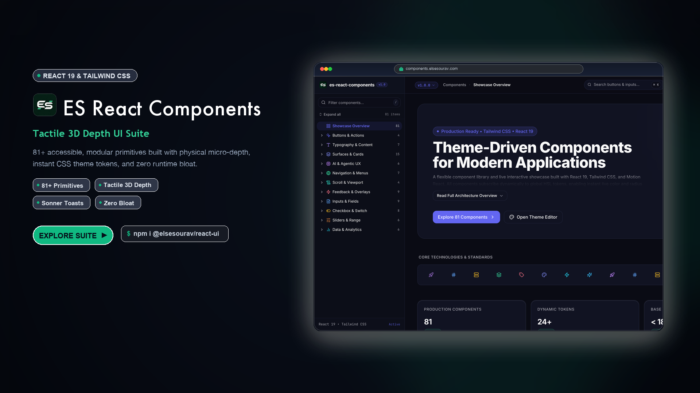
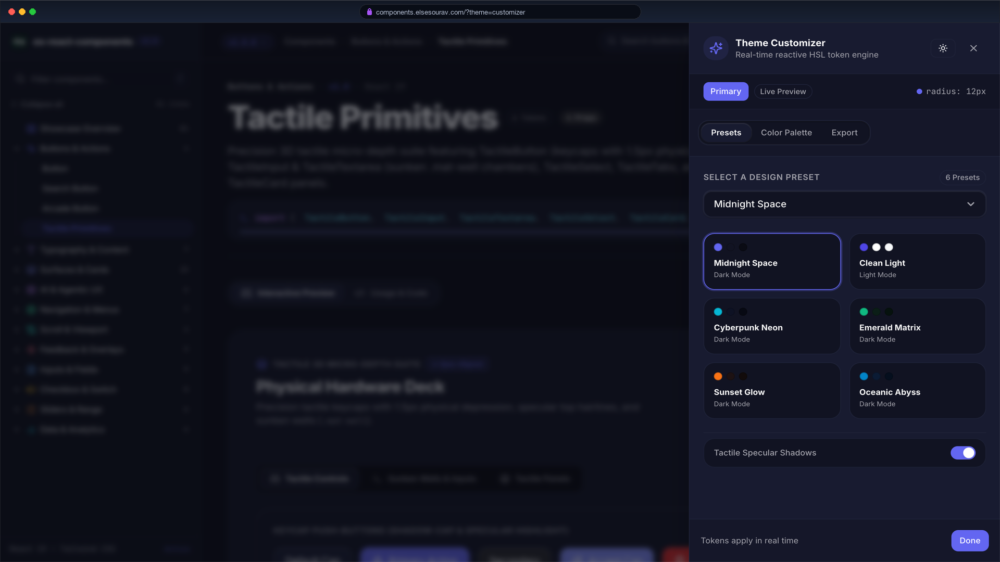

<div align="center">
  
  <h1>ES React Components</h1>
  <p>A tactile, themeable UI component library built for React 19 and Tailwind CSS.</p>

  <p>
    <a href="https://components.elsesourav.com"><strong>Live Demo & Docs</strong></a> ·
    <a href="https://www.npmjs.com/package/@elsesourav/react-ui"><strong>npm package</strong></a> ·
    <a href="https://elsesourav.com"><strong>elsesourav.com</strong></a>
  </p>
</div>

<br />

<p align="center">
  
</p>

---

## About

`@elsesourav/react-ui` is a personal component library I built to power my web applications and platforms at [elsesourav.com](https://elsesourav.com).

I wanted a system that feels physical and tactile—with subtle 3D keycaps, 1.5px press travel, and sunken container wells—while staying lightweight and simple to re-theme using CSS variables.

### Key Features

- **81+ Components**: Buttons, inputs, dialogs, 3D toast stack, image cropper studio, charts, and tactile primitives.
- **Tactile 3D Depth**: Push buttons with physical key travel, top specular highlights, and sunken `.mat-well` cavities.
- **Instant Theming**: Styled with Tailwind CSS and CSS custom properties (`--primary`, `--background`, `--surface`, etc.). Themes update live without any CSS-in-JS runtime overhead.
- **React 19 Native**: Built natively for React 19 and TypeScript with strict types.

---

## Previews

### 1. Tactile 3D Suite
Physical keycaps with press travel, sunken input wells, and tactile badges.

<p align="center">
  
</p>

### 2. Live Theme Customizer
Change themes on the fly using built-in presets (Midnight Space, Clean Light, Cyberpunk Neon, Emerald Matrix, etc.) or custom color pickers.

<p align="center">
  
</p>

### 3. Studio Image Cropper
Responsive modal with locked aspect ratio presets (16:9, 21:9, 3:4, 1:1) and direct clipboard image paste (`Cmd+V` / `Ctrl+V`).

<p align="center">
  
</p>

---

## Installation

```bash
# Using pnpm
pnpm add @elsesourav/react-ui

# Using npm
npm install @elsesourav/react-ui
```

### Tailwind Setup

Add the library to your `tailwind.config.ts`:

```ts
import type { Config } from 'tailwindcss';

export default {
  darkMode: ['class', '[data-theme="dark"]'],
  content: [
    './src/**/*.{ts,tsx}',
    './node_modules/@elsesourav/react-ui/dist/**/*.{js,ts,jsx,tsx}',
  ],
  theme: {
    extend: {
      colors: {
        primary: 'hsl(var(--primary) / <alpha-value>)',
        background: 'hsl(var(--background) / <alpha-value>)',
        surface: 'hsl(var(--surface) / <alpha-value>)',
        border: 'hsl(var(--border) / <alpha-value>)',
        well: 'hsl(var(--well) / <alpha-value>)',
        panel: 'hsl(var(--panel) / <alpha-value>)',
      },
    },
  },
} satisfies Config;
```

---

## Quick Example

```tsx
import { TactileButton, TactileCard, TactileInput } from '@elsesourav/react-ui';

export function ExampleCard() {
  return (
    <TactileCard className="p-6 max-w-sm space-y-4">
      <h3 className="text-lg font-bold text-white">Create Project</h3>
      <TactileInput placeholder="Project title..." />
      <TactileButton variant="primary" className="w-full">
        Save & Continue
      </TactileButton>
    </TactileCard>
  );
}
```

---

## Component Overview

The library includes 81+ accessible primitives across several categories:

- **Tactile 3D**: `TactileButton`, `TactileInput`, `TactileTextarea`, `TactileSelect`, `TactileCard`, `TactileTabs`, `TactileBadge`
- **Buttons & Actions**: `Button`, `ArcadeButton`, `KeycapButton`, `InteractivePressable`
- **Forms & Inputs**: `Input`, `FloatingLabelInput`, `PasswordInput`, `OtpInput`, `TagInput`, `ExpandingSearch`, `Textarea`, `Select`, `Switch`, `SquishSwitch`, `Checkbox`, `QuantityCounter`
- **Surfaces & Layout**: `Card`, `Stat`, `LeaderboardTable`, `TreeView`, `ReorderList`, `LiquidGlassSheet`
- **Media & Studio**: `ImageUpload`, `ImageCropUpload`, `BlurUpImage`, `Lightbox`, `CardCoverflow`, `CardCarousel`
- **Feedback & Overlays**: `Dialog`, `Modal`, `Alert`, `Toast` (Sonner-style card stack), `Spinner`, `MotionLoaders`, `CollapsibleBanner`, `Tooltip`
- **Data & Charts**: `MonoLineChart`, `MonoBarChart`, `MonoAreaChart`, `MonoDonutChart`, `MonoStreamChart`
- **AI UX**: `AIPromptBar`, `AIApprovalCard`, `AIFineTuneCard`, `AICodeBlock`

Visit the [interactive showcase](https://components.elsesourav.com) to view live component previews, props tables, and copy-paste code snippets.

---

## Notes on Open-Source & Customizations

Some components in this library were adapted and modified from existing open-source work:
- The toast notification system borrows card-stack physics inspired by Sonner, rebuilt with solid opaque background tokens and tactile elevation.
- The charts wrap Recharts primitives with a monochromatic style tied directly to active CSS theme tokens.
- Several overlay and input interactions follow Radix / WAI-ARIA patterns, simplified for my personal stack with native React 19 support.

---

## License

MIT © [Sourav](https://github.com/elsesourav)
